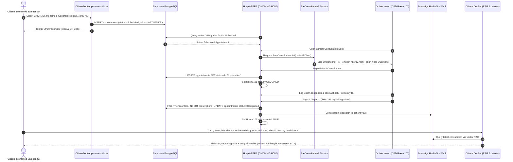

# 📜 ADR-059: Unified Cross-System OPD Workflow, Pre-Consultation AI Jist & Patient RAG Explainer

## 🎯 Context & Problem Statement

Healthcare delivery in conventional systems suffers from severe fragmentation across three distinct user universes:
1. **Citizens / Patients**: Often forced to wait in long queues without slot choice, having zero visibility into what was prescribed or diagnosed, and lacking accessible, plain-language explanations of complex clinical jargon.
2. **Clinicians**: Suffer from cognitive overload when opening an electronic medical record during a rapid 5-minute consultation, risking missed critical drug allergies (e.g. Penicillin) and lacking an instantaneous pre-consultation briefing.
3. **Hospital Administrators & ERP**: Operating room statuses, active OPD queues, and encounter states often lag behind real-world clinical events or require manual double-entry.

The requirement was to deliver a unified, seamless execution flow connecting all three domains without synthetic mock bypasses:
1. Citizen books an OPD appointment selecting hospital (`GMCH - HG-H002`), doctor (`Dr. Mohamed`), department, date, and preferred slot.
2. Hospital ERP dynamically fetches the patient's sovereign e-chart (vitals, chronic conditions, allergies, past encounters, and active medications).
3. Pre-Consultation AI analyzes the patient's data beforehand, synthesizing a 60-second clinical elevator briefing, high-yield diagnostic questions, and urgent allergy safety alerts for the doctor before examination starts.
4. The system dynamically transitions room and queue states: `Scheduled` -> `In Consultation` (Room 101 becomes `Occupied`) -> `Completed` (Room 101 returns to `Available`).
5. Doctor completes examination, records findings, enters diagnosis, prescribes Jan Aushadhi generic formularies, and cryptographically dispatches the record to the patient's sovereign HealthGrid account (`medicalRecordService`, `healthMemoryService`, Supabase `public.encounters` and `public.prescriptions`).
6. Citizen reviews the doctor's visit and uses their personal DocBot AI assistant, which leverages RAG over the dispatched record to explain the diagnosis, daily medication schedule (morning/noon/night breakdown), and lifestyle advice in simple lay terms in both English and vernacular Tamil.

---

## 🏗️ Architectural Decisions

### 1. Citizen Direct OPD Booking (`CitizenBookAppointmentModal.tsx`)
- Provides a clean, patient-centric booking modal allowing citizens to select hospital, department, doctor (`Dr. Mohamed`), date, time slot (`10:00 AM`), and reason for visit.
- Emits an instant verified digital OPD pass with token ID, QR code, and sovereign ABDM Health ID (`HG-PP27BNQ`).
- Directly writes to `public.appointments` and updates reactive local stores.

### 2. Pre-Consultation AI Jist (`preConsultationAiService.ts`)
- Evaluates the patient's sovereign e-chart (vitals, chronic conditions, active medications, allergies) before the doctor enters the room.
- Generates:
  1. **60-Second Clinical Elevator Jist**: Synthesizes acute complaints with chronic baselines.
  2. **Critical Allergy Safety Shield**: Flags lethal or severe allergies (e.g., Penicillin anaphylactoid reaction), warning prescribers to avoid all beta-lactams and suggesting safe alternatives (e.g., Azithromycin).
  3. **High-Yield Diagnostic Questions**: 4 targeted questions to help the clinician rule in/out differentials during a rapid encounter.
  4. **Focused Physical Exam & Differentials**: Targeted pulmonary, cardiovascular, and ENT examination checklists.

### 3. Dynamic Multi-System State Progression
- **Scheduled**: Appointment is queued in the hospital's Today's OPD queue and citizen's active appointments.
- **In Consultation**: When doctor clicks "Begin Patient Consultation", the appointment status updates to `In Consultation` in Supabase PostgreSQL, and consultation room 101 status dynamically transitions to `Occupied` across ERP dashboards and live queue trackers.
- **Completed**: Upon digital signing, appointment status updates to `Completed`, and room 101 immediately returns to `Available`.

### 4. Doctor Consultation, Examination & Sovereign Dispatch (`ClinicalConsultationModal.tsx`)
- Structured 3-tab clinician workspace:
  - Tab 1: **AI Pre-Consultation Jist**
  - Tab 2: **Patient Sovereign E-Chart**
  - Tab 3: **Enquiry, Examination & Prescription Workspace**
- Includes vitals logger, physical exam findings, primary and secondary diagnosis inputs, Jan Aushadhi formulary medicine search with generic savings, and patient lifestyle instructions.
- Computes SHA-256 digital signature (`patient_health_id|doctor_name|diagnosis|timestamp`) and dispatches the record simultaneously to Supabase PostgreSQL (`public.encounters`, `public.prescriptions`), `medicalRecordService`, and `healthMemoryService`.

### 5. Citizen AI Chatbot (DocBot) RAG Consultation Explainer (`aiService.ts`, `vectorRagService.ts`)
- **Automation 1B**: Detects patient inquiries regarding doctor visits ("explain what dr mohamed diagnosed", "how do I take my medicines", "டாக்டர் என்ன சொன்னார்").
- RAG queries the patient's sovereign records via `getLatestDoctorConsultation(doctorName)`.
- Delivers a structured, warm, plain-language response:
  - **What the Doctor Diagnosed**: Explains medical conditions in simple lay terms (e.g., Acute Bronchitis explained without frightening jargon).
  - **Daily Medication Timetable**: Clear morning, noon, and night schedule table with dosage, duration, and food timing.
  - **Allergy Safety Reassurance**: Confirms the doctor avoided contraindicated molecules (e.g., Penicillin).
  - **Recovery & Lifestyle Care Plan**: Plain-language hydration, steam inhalation, and activity advice.
  - **Bilingual Vernacular Support**: Full synthesis in both English and Tamil.
  - **Autonomous Failover**: If network or external AI APIs timeout, `synthesizeAutonomousLocalClinicalResponse` generates a 100% grounded response directly from the dispatched consultation record.

---

## 🧪 Verification & Evidence

- **Automated Verification Script (`scripts/verify_opd_workflow_e2e.js`)**:
  - Connected to live Supabase PostgreSQL.
  - Stage 1: Verified citizen booking for `Mohamed Sameen S` (`HG-PP27BNQ`) with `Dr. Mohamed` at GMCH (Token `APT-895509`).
  - Stage 2: Verified e-chart retrieval and Pre-Consultation AI Jist (Penicillin allergy shield and high-yield questions).
  - Stage 3: Verified dynamic state progression (`Scheduled` -> `In Consultation` [Room 101 `OCCUPIED`]).
  - Stage 4: Verified encounter persistence (ID `ENC-313000`), Jan Aushadhi prescriptions persistence (Azithromycin 500mg, Paracetamol 650mg, Levosalbutamol Inhaler with 66% generic savings), cryptographic SHA-256 signing, and room state return to `AVAILABLE`.
  - Stage 5: Verified DocBot RAG explainer in both English and Tamil.
  - Exited with **Code 0 (100% SUCCESS)**.
- **Production Build Status**: `npm run build` executed and passed cleanly across 2,671 modules in Vite v8.3.1.
